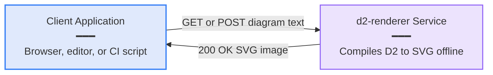
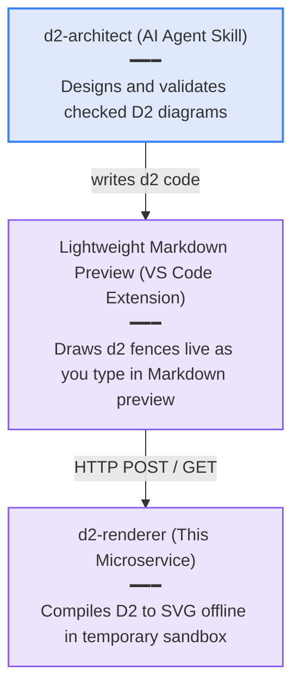

# d2-renderer: render D2 diagrams to SVG over HTTP

`d2-renderer` is an HTTP service and container image that compiles declarative [D2](https://d2lang.com/) diagram code into SVG images.

- **Core Capabilities:**
  - Compiles D2 text into vector SVG graphics through HTTP GET and POST endpoints.
  - Eliminates local toolchain setup by bundling the D2 compiler, layout engines (Dagre, ELK, TALA), and system fonts inside a single container image.
- **Operational Footprints:**
  - Runs as a multi-architecture Docker container on `linux/amd64` and `linux/arm64`.
  - Runs as a standalone Python 3.12 script using standard library modules.
  - Deploys as a serverless container on Google Cloud Run with scale-to-zero cost controls.
- **Isolation and Privacy:**
  - Compiles diagrams in an isolated temporary directory with `--bundle=false` to block outbound network requests.
  - Keeps diagram source code and architectural designs within your private infrastructure.

**Diagram: A client sends diagram text over HTTP and receives an SVG image**



---

## Why D2 & Why This Service Exists

Mermaid is widely adopted because GitHub renders it natively, but complex architecture models often exceed its layout and nesting capabilities. D2 solves these modeling limits, and `d2-renderer` provides the rendering service to display D2 diagrams without external dependencies.

- **D2 Modeling Strengths:**
  - Supports native nested containers and explicit container boundaries.
  - Provides multiple layout engines including Dagre, ELK, and TALA.
  - Includes built-in shapes for SQL tables, sequence lifelines, and class models.
  - Offers hand-drawn sketch styling and paired light/dark themes.
- **Rendering Challenges:**
  - GitHub and GitLab render `d2` code blocks as unformatted text.
  - Public rendering services require transmitting private architecture models over third-party networks.
  - Distributing local CLI binaries, fonts, and layout plugins across developer machines causes environment drift.
- **How d2-renderer Resolves These Challenges:**
  - Provides a self-hosted rendering endpoint that you control completely.
  - Compiles diagrams offline with `--bundle=false` to block outbound network access.
  - Standardizes output across local editors, continuous integration workflows, and published documentation.

---

## The D2 Authoring Ecosystem

`d2-renderer` operates as the rendering component within a three-part toolchain for technical documentation:

**Diagram: The D2 authoring pipeline connects agent design, editor preview, and offline microservice compilation**



| Component | Responsibility | Links |
| :--- | :--- | :--- |
| **d2-renderer** (This Service) | Converts D2 text to SVG via standard HTTP with offline isolation. | [Setup Guide](./docs/010-setup/README.md) |
| **[Lightweight Markdown Preview](https://github.com/kanad13/lightweight-markdown-preview)** | VS Code extension that renders D2 fences live as you type. | [VS Code Marketplace](https://marketplace.visualstudio.com/items?itemName=KunalPathak.lightweight-markdown-preview) · [Open VSX](https://open-vsx.org/extension/KunalPathak/lightweight-markdown-preview) |
| **[d2-architect](https://github.com/kanad13/coherent-output/tree/main/skills/d2-architect)** | AI agent skill that adds checked, TALA-laid-out D2 diagrams to documentation. | [GitHub Repository](https://github.com/kanad13/coherent-output/tree/main/skills/d2-architect) |

---

## Operational Footprints

Choose the deployment model that matches your infrastructure and security policies:

| Footprint | When to Choose | Key Characteristics | Setup Guide |
| :--- | :--- | :--- | :--- |
| **Docker Container** | You have Docker or Podman installed. | Zero local toolchain install; bundles D2 compiler, layout engines, and fonts; multi-arch (`amd64`/`arm64`). | [Docker Runbook](./docs/010-setup/010-docker.md) |
| **Native Python** | You want zero container overhead or Docker is restricted. | Python standard library only; zero `pip` packages; instant startup; executes local `d2` binary safely. | [Native Python Runbook](./docs/010-setup/020-local-python.md) |
| **Google Cloud Run** | You want a shared team service or public `` URLs. | Serverless scale-to-zero; free-tier friendly; keyless OIDC GitHub deployment; 1-command public IAM toggle. | [Cloud Run Runbook](./docs/010-setup/030-cloud-run.md) |

- **Contract Consistency:**
  - Every footprint exposes the identical HTTP API contract.
  - Switching between local Docker, native Python, and Cloud Run requires changing only the base URL.

---

## Quick Start

Send diagram text to a running service using HTTP POST or GET:

- **POST Raw Diagram Text:**
  - Pipe raw D2 text directly into `/d2/svg`:

```bash
printf 'client -> server: request\nserver -> client: response' \
  | curl -X POST --data-binary @- http://localhost:8088/d2/svg -o hello.svg
```

- **Embed via GET Request:**
  - Reference compressed, base64-encoded diagram text in Markdown or HTML image tags:

```markdown

```

Consult the [API Reference](./docs/020-api-reference.md) for query parameters including `?sketch=true`, `?theme=<id>`, and `?layout=dagre|elk|tala`.

---

## Visual Gallery and Verification

- **Visual Gallery:**
  - Browse the [Visualization Gallery](./docs/040-visualizations/README.md) to inspect sample architectures, database schemas, sequence diagrams, and CI/CD pipelines.
- **Live Preview Verification:**
  - Open [010-test-preview.md](./docs/040-visualizations/010-test-preview.md) in VS Code with the [Lightweight Markdown Preview](https://marketplace.visualstudio.com/items?itemName=KunalPathak.lightweight-markdown-preview) extension to verify that unrendered code fences convert to interactive SVGs.

---

## Core Features and Guarantees

| Feature | Mechanism | Benefit |
| :--- | :--- | :--- |
| **Private Rendering** | Compiles locally inside your container or host process | Architecture designs never leave your control. |
| **Offline Compiles** | Runs `d2 --bundle=false` in an empty temporary directory | Diagrams cannot fetch external icon URLs or import server files. See [Decision 006](./docs/060-decisions.md#decision-006---offline-compile-in-an-empty-directory). |
| **Zero Dependencies** | Server uses only Python standard library | Single clean file; zero pip vulnerability management. |
| **Multi-Architecture** | Multi-arch image manifests (`linux/amd64`, `linux/arm64`) | Runs natively on Intel/AMD and Apple Silicon without emulation. |
| **In-Memory Cache** | Least-recently-used (LRU) memory cache (256 entries) | Repeated requests resolve in ~1.2 ms without spawning processes. |
| **Readable Errors** | One-line RFC status with full plain-text compiler diagnostics | Strict HTTP clients parse errors without crashing. |
| **Bounded Resources** | Caps input size (256 KiB), compile time (20s), and instances | Protects public instances from memory and CPU exhaustion. |

---

## Security and Isolation

Because `d2-renderer` can run as an open public microservice, it treats all diagram text as untrusted input across all environments.

| Risk Surface | Defense Mechanism |
| :--- | :--- |
| **Icon URLs and SSRF** | Compiles with `--bundle=false`. Diagram icon URLs remain un-fetched `<image href>` references. |
| **Local File Inclusion** | Compiles in an ephemeral empty directory; imports (`...@path`) find no host files. |
| **Decompression Bombs** | Rejects payloads exceeding `MAX_SOURCE_BYTES` (256 KiB) both raw and after inflation (`413`). |
| **Runaway Renders** | Terminated after `RENDER_TIMEOUT_SECONDS` (20s) with `504 Gateway Timeout`. |
| **Process Privileges** | Docker image runs as dedicated non-root `appuser`. |
| **Secrets Management** | Zero secrets stored in repository. Cloud Run deploys use keyless GitHub OIDC federation. |

Review the [Security Policy](./SECURITY.md) for vulnerability reporting procedures and threat models.

---

## Documentation Index

| Guide | Description |
| :--- | :--- |
| [**Deployment & Setup**](./docs/010-setup/README.md) | Setup guides for Docker, native Python, and Cloud Run deployments. |
| [**Visualization Gallery**](./docs/040-visualizations/README.md) | Showcase of architecture diagrams, schemas, and styling options. |
| [**Render Verification**](./docs/040-visualizations/010-test-preview.md) | Markdown document for verifying live editor preview. |
| [**API Reference**](./docs/020-api-reference.md) | Endpoints, query parameters, encoding formats, and status codes. |
| [**Architecture**](./docs/030-architecture.md) | System components, request flow diagrams, caching, and resource limits. |
| [**Operations**](./docs/050-operations.md) | Cost controls, rollback procedures, logging, and public access IAM toggles. |
| [**Decision Records**](./docs/060-decisions.md) | Architectural Decision Records (ADRs) explaining technical trade-offs. |
| [**Examples**](./docs/090-examples/README.md) | Sample `.d2` files with rendered SVGs and curl commands. |
| [**Testing Guide**](./TESTING.md) | Integration test map, sabotage checks, and verification procedures. |
| [**AGENTS.md**](./AGENTS.md) | Repository instructions for coding agents. |

---

## License

[MIT](./LICENSE)
