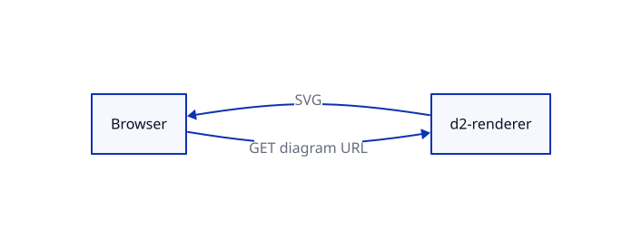
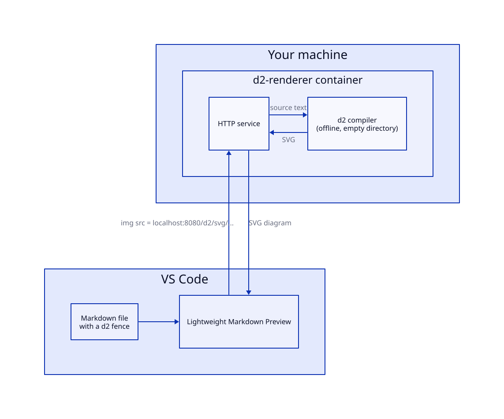
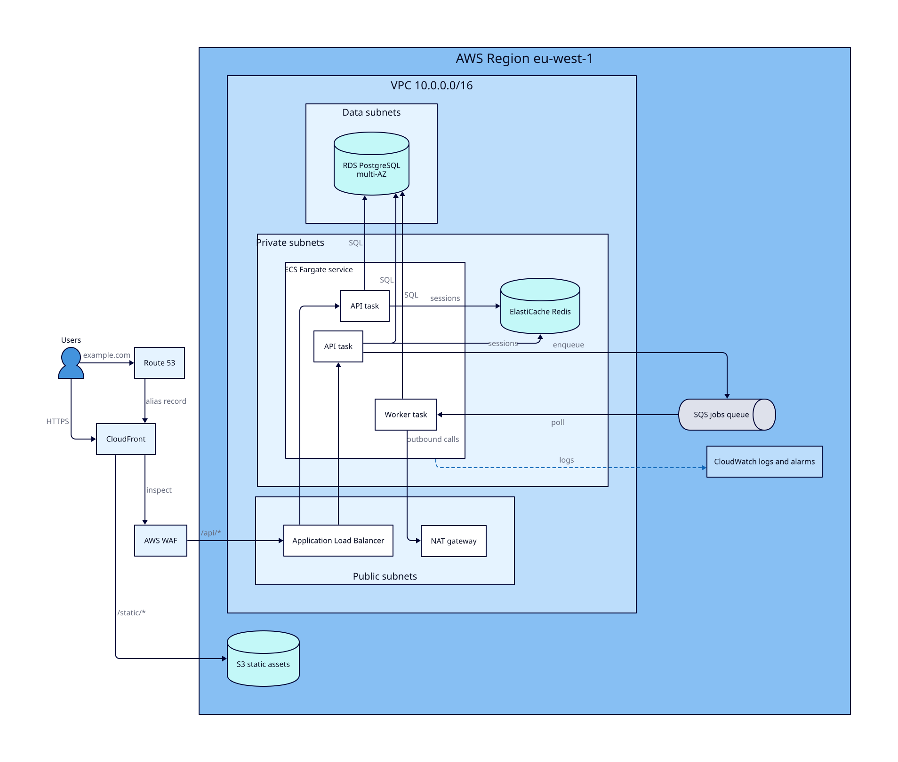
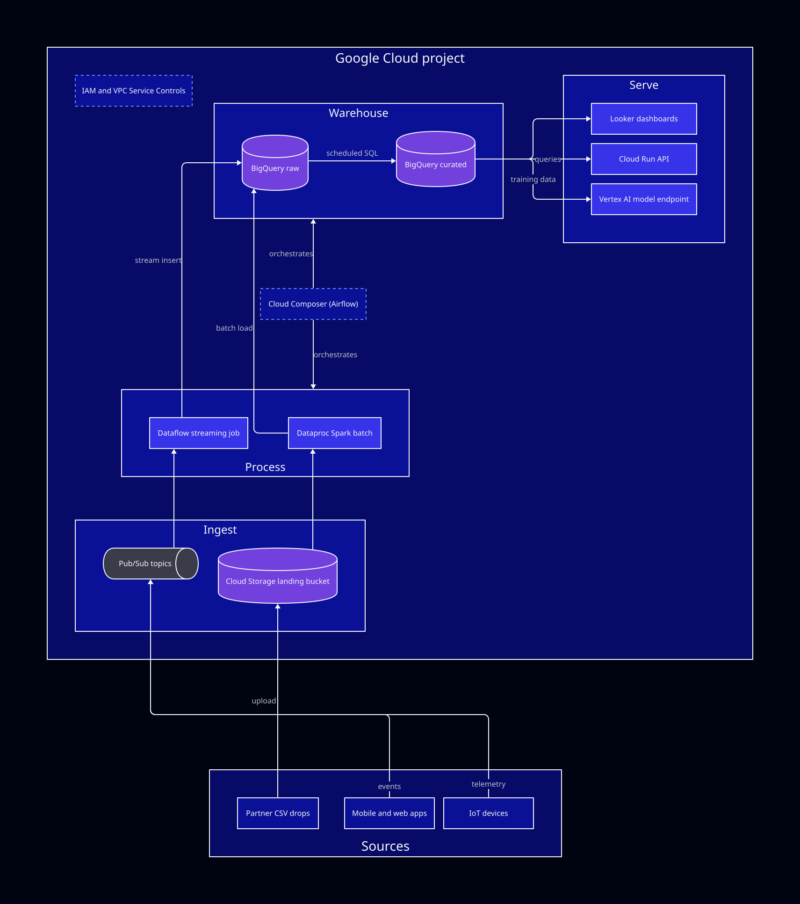
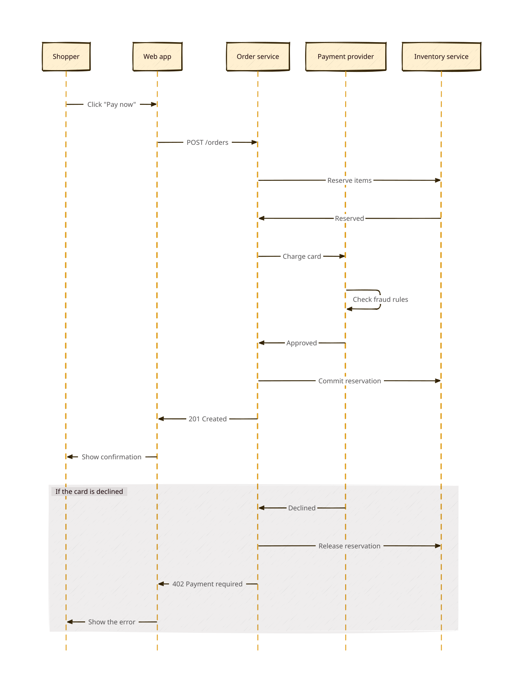
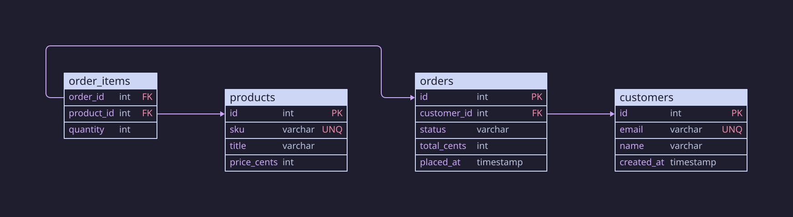
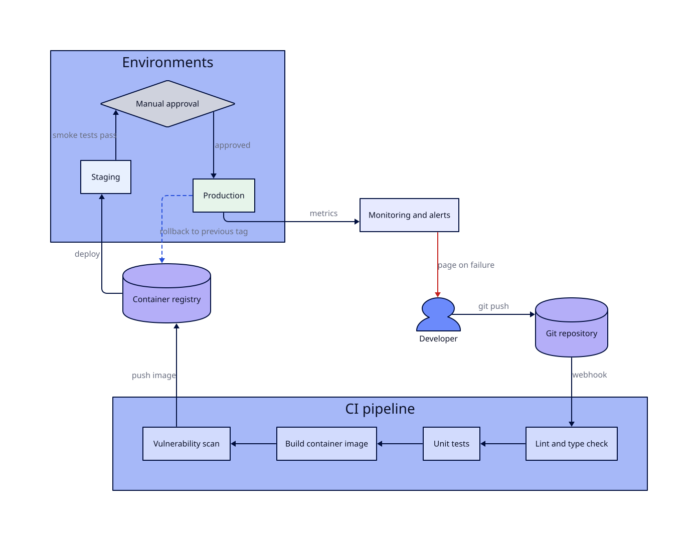

# d2-renderer

Turn [D2](https://d2lang.com) diagram text into SVG with one `docker run`.



<!-- d2-source: examples/hello.d2 -->
<details>
<summary>D2 source</summary>

```d2
vars: {
  d2-config: {
    layout-engine: dagre
  }
}
direction: right
Browser -> d2-renderer: GET diagram URL
d2-renderer -> Browser: SVG
```

</details>

## The problem

D2 describes a diagram as plain text, and a compiler turns that text into a picture. The picture is the hard part to deliver:

- **Markdown previews, blogs and wikis:**
  - They show text and images, and they cannot run the D2 compiler.
  - GitHub shows a `d2` code fence as code, not as a diagram.
- **Hosted renderers:**
  - They draw the diagram for you.
  - They also receive every diagram you send, including private architecture notes.
- **Installing D2 on every machine:**
  - It works for one person and breaks down for a team, a CI job or a public page.

## What d2-renderer does

d2-renderer wraps the `d2` compiler in a small HTTP service inside one container. You send diagram text and receive an SVG back. You run the container on your own machine or on a cloud host you control, so your diagram text stays with you.



<!-- d2-source: docs/diagrams/local-use.d2 -->
<details>
<summary>D2 source</summary>

```d2
direction: right

editor: VS Code {
  md: "Markdown file\nwith a d2 fence"
  ext: Lightweight Markdown Preview
  md -> ext
}

box: Your machine {
  container: d2-renderer container {
    server: HTTP service
    d2: d2 compiler\n(offline, empty directory)
    server -> d2: source text
    d2 -> server: SVG
  }
}

editor.ext -> box.container.server: "img src = localhost:8080/d2/svg/..."
box.container.server -> editor.ext: SVG diagram
```

</details>

## What D2 can draw

D2 diagrams are a few lines of text. Each picture below came from the source shown under it, drawn by this service. They cover light and dark themes, a hand-drawn style, and architectures with nested boxes, queues and databases. Open **D2 source** to copy the code.

### AWS web application

A three-tier AWS stack in the default light style: CloudFront and WAF in front, an ECS service in private subnets, and Redis, PostgreSQL and a queue behind it.



<!-- d2-source: examples/aws-web-architecture.d2 -->
<details>
<summary>D2 source</summary>

```d2
vars: {
  d2-config: {
    theme-id: 4
  }
}
direction: right

users: Users {
  shape: person
}
dns: Route 53
cdn: CloudFront
waf: AWS WAF

users -> dns: example.com
users -> cdn: HTTPS
cdn -> waf: inspect

aws: AWS Region eu-west-1 {
  s3: S3 static assets {
    shape: cylinder
  }

  vpc: VPC 10.0.0.0/16 {
    public: Public subnets {
      alb: Application Load Balancer
      nat: NAT gateway
    }
    private: Private subnets {
      ecs: ECS Fargate service {
        api1: API task
        api2: API task
        worker: Worker task
      }
      cache: ElastiCache Redis {
        shape: cylinder
      }
    }
    data: Data subnets {
      rds: RDS PostgreSQL\nmulti-AZ {
        shape: cylinder
      }
    }
  }

  sqs: SQS jobs queue {
    shape: queue
  }
  logs: CloudWatch logs and alarms
}

dns -> cdn: alias record
cdn -> aws.s3: /static/*
waf -> aws.vpc.public.alb: /api/*
aws.vpc.public.alb -> aws.vpc.private.ecs.api1
aws.vpc.public.alb -> aws.vpc.private.ecs.api2
aws.vpc.private.ecs.api1 -> aws.vpc.private.cache: sessions
aws.vpc.private.ecs.api2 -> aws.vpc.private.cache: sessions
aws.vpc.private.ecs.api1 -> aws.vpc.data.rds: SQL
aws.vpc.private.ecs.api2 -> aws.vpc.data.rds: SQL
aws.vpc.private.ecs.api1 -> aws.sqs: enqueue
aws.sqs -> aws.vpc.private.ecs.worker: poll
aws.vpc.private.ecs.worker -> aws.vpc.data.rds: SQL
aws.vpc.private.ecs.worker -> aws.vpc.public.nat: outbound calls
aws.vpc.private.ecs -> aws.logs: logs {
  style.stroke-dash: 3
}
```

</details>

### Google Cloud data platform

A dark theme (`theme-id: 201`) with ingest, processing, warehouse and serving stages, and an orchestrator that spans them.



<!-- d2-source: examples/gcp-data-platform.d2 -->
<details>
<summary>D2 source</summary>

```d2
vars: {
  d2-config: {
    theme-id: 201
  }
}
direction: right

sources: Sources {
  apps: Mobile and web apps
  iot: IoT devices
  files: Partner CSV drops
}

gcp: Google Cloud project {
  ingest: Ingest {
    pubsub: Pub/Sub topics {
      shape: queue
    }
    gcs: Cloud Storage landing bucket {
      shape: cylinder
    }
  }

  process: Process {
    dataflow: Dataflow streaming job
    dataproc: Dataproc Spark batch
  }

  warehouse: Warehouse {
    raw: BigQuery raw {
      shape: cylinder
    }
    curated: BigQuery curated {
      shape: cylinder
    }
  }

  serve: Serve {
    looker: Looker dashboards
    run: Cloud Run API
    vertex: Vertex AI model endpoint
  }

  composer: Cloud Composer (Airflow) {
    style.stroke-dash: 3
  }
  iam: IAM and VPC Service Controls {
    style.stroke-dash: 3
  }
}

sources.apps -> gcp.ingest.pubsub: events
sources.iot -> gcp.ingest.pubsub: telemetry
sources.files -> gcp.ingest.gcs: upload
gcp.ingest.pubsub -> gcp.process.dataflow
gcp.ingest.gcs -> gcp.process.dataproc
gcp.process.dataflow -> gcp.warehouse.raw: stream insert
gcp.process.dataproc -> gcp.warehouse.raw: batch load
gcp.warehouse.raw -> gcp.warehouse.curated: scheduled SQL
gcp.warehouse.curated -> gcp.serve.looker
gcp.warehouse.curated -> gcp.serve.run: queries
gcp.warehouse.curated -> gcp.serve.vertex: training data
gcp.composer -> gcp.process: orchestrates
gcp.composer -> gcp.warehouse: orchestrates
```

</details>

### Checkout sequence, hand-drawn

A sequence diagram with `sketch: true` and a warm theme, including a group for the failure path.



<!-- d2-source: examples/checkout-sequence.d2 -->
<details>
<summary>D2 source</summary>

```d2
vars: {
  d2-config: {
    sketch: true
    theme-id: 105
  }
}
shape: sequence_diagram

shopper: Shopper
web: Web app
orders: Order service
pay: Payment provider
stock: Inventory service

shopper -> web: Click "Pay now"
web -> orders: POST /orders
orders -> stock: Reserve items
stock -> orders: Reserved
orders -> pay: Charge card
pay -> pay: Check fraud rules
pay -> orders: Approved
orders -> stock: Commit reservation
orders -> web: 201 Created
web -> shopper: Show confirmation

declined: If the card is declined {
  pay -> orders: Declined
  orders -> stock: Release reservation
  orders -> web: 402 Payment required
  web -> shopper: Show the error
}
```

</details>

### Database schema

`sql_table` shapes, primary and foreign keys, and relationships drawn as arrows, in a dark mauve theme.



<!-- d2-source: examples/orders-schema.d2 -->
<details>
<summary>D2 source</summary>

```d2
vars: {
  d2-config: {
    theme-id: 200
  }
}
direction: right

customers: customers {
  shape: sql_table
  id: int {constraint: primary_key}
  email: varchar {constraint: unique}
  name: varchar
  created_at: timestamp
}

orders: orders {
  shape: sql_table
  id: int {constraint: primary_key}
  customer_id: int {constraint: foreign_key}
  status: varchar
  total_cents: int
  placed_at: timestamp
}

order_items: order_items {
  shape: sql_table
  order_id: int {constraint: foreign_key}
  product_id: int {constraint: foreign_key}
  quantity: int
}

products: products {
  shape: sql_table
  id: int {constraint: primary_key}
  sku: varchar {constraint: unique}
  title: varchar
  price_cents: int
}

orders.customer_id -> customers.id
order_items.order_id -> orders.id
order_items.product_id -> products.id
```

</details>

### CI/CD pipeline

People, repositories, a pipeline, an approval gate and a rollback path in one picture.



<!-- d2-source: examples/cicd-pipeline.d2 -->
<details>
<summary>D2 source</summary>

```d2
vars: {
  d2-config: {
    theme-id: 3
  }
}
direction: right

dev: Developer {
  shape: person
}

repo: Git repository {
  shape: cylinder
}

ci: CI pipeline {
  lint: Lint and type check
  unit: Unit tests
  build: Build container image
  scan: Vulnerability scan
  lint -> unit -> build -> scan
}

registry: Container registry {
  shape: cylinder
}

envs: Environments {
  staging: Staging {
    style.fill: "#E8F0FE"
  }
  approval: Manual approval {
    shape: diamond
  }
  prod: Production {
    style.fill: "#E6F4EA"
  }
  staging -> approval: smoke tests pass
  approval -> prod: approved
}

alerts: Monitoring and alerts

dev -> repo: git push
repo -> ci.lint: webhook
ci.scan -> registry: push image
registry -> envs.staging: deploy
envs.prod -> alerts: metrics
alerts -> dev: page on failure {
  style.stroke: "#C5221F"
}
envs.prod -> registry: rollback to previous tag {
  style.stroke-dash: 3
}
```

</details>

More examples, with the render commands, are in [examples](./examples/README.md).

## Quickstart

Start the service:

```bash
docker run -d --name d2-renderer -p 8080:8080 ghcr.io/kanad13/d2-renderer:latest
```

Render a diagram:

```bash
printf 'client -> server: request\nserver -> client: response' \
  | curl -X POST --data-binary @- http://localhost:8080/d2/svg -o hello.svg
```

Open `hello.svg` in a browser. The same image tag runs on Intel/AMD machines and on Apple Silicon Macs, with no `--platform` flag. More ways to run it are in [Run locally](./docs/010-run-locally.md).

## Why use it

| You get                     | How                                                                                                                                                                                                                                                       |
| :-------------------------- | :-------------------------------------------------------------------------------------------------------------------------------------------------------------------------------------------------------------------------------------------------------- |
| **Private rendering**       | The compiler runs in your container. Diagram text goes nowhere else.                                                                                                                                                                                      |
| **Offline, safe compiles**  | Each compile makes no network requests and runs in an empty directory, so a diagram cannot fetch addresses or read server files. Icon URLs stay as references in the SVG. See [decision 060](./docs/decisions/060-offline-compile-in-empty-directory.md). |
| **No D2 install**           | Clients need only an HTTP call or an `` tag.                                                                                                                                                                                                         |
| **Native on Intel and Arm** | One tag serves `linux/amd64` and `linux/arm64`.                                                                                                                                                                                                           |
| **Fast repeats**            | An in-memory cache answers a repeated diagram in about a millisecond (1.2 ms measured end to end on localhost).                                                                                                                                           |
| **Readable errors**         | Every error reply has a one-line status and a plain-text body with the full compiler message, so strict clients such as Node's `fetch` read it directly.                                                                                                  |
| **Layouts and styles**      | `?sketch=true`, `?theme=<id>` and `?layout=dagre\|elk\|tala` pass straight to D2.                                                                                                                                                                         |
| **Safe to publish**         | Input size, render time, cache size and instance count are all capped. See [architecture](./docs/030-architecture.md#limits-and-why-they-exist).                                                                                                          |
| **Standard-library server** | The Python service has no dependencies beyond the standard library.                                                                                                                                                                                       |

## Use it with VS Code

Lightweight Markdown Preview draws your ```d2 fences with this service. Start the container, run **Markdown: Choose D2 Renderer** and pick the local Docker container.

- [Visual Studio Marketplace](https://marketplace.visualstudio.com/items?itemName=KunalPathak.lightweight-markdown-preview)
- [Open VSX](https://open-vsx.org/extension/KunalPathak/lightweight-markdown-preview)
- [GitHub](https://github.com/kanad13/lightweight-markdown-preview)
- [D2 guide](https://github.com/kanad13/lightweight-markdown-preview/blob/main/docs/d2.md)

## Use it from anywhere else

- **An `` tag on a page you publish:**
  - Encode the diagram into the URL, then point `src` at the service.
  - The format is in the [API reference](./docs/020-api-reference.md#get-d2svgpayload).
- **A script or build step:**
  - POST the raw text to `/d2/svg`, as in the quickstart.
- **A public instance:**
  - Deploy the same image to Google Cloud Run with the [deploy runbook](./docs/040-deploy-gcp.md). A push to `main` tests, publishes and deploys.

## Documentation

| Read                                                   | When you want to                                           |
| :----------------------------------------------------- | :--------------------------------------------------------- |
| [Run locally](./docs/010-run-locally.md)               | Run, update, configure or troubleshoot the container.      |
| [API reference](./docs/020-api-reference.md)           | Call the service: endpoints, parameters, errors, encoding. |
| [Architecture](./docs/030-architecture.md)             | See how a request flows and why each limit exists.         |
| [Deploy to Google Cloud Run](./docs/040-deploy-gcp.md) | Run a public instance.                                     |
| [Operations](./docs/050-operations.md)                 | Manage cost, roll back, read logs, tune limits.            |
| [Decision records](./docs/decisions/README.md)         | Learn why the project is built this way.                   |
| [Examples](./examples/README.md)                       | See rendered diagrams next to their source.                |
| [Testing](./TESTING.md)                                | Run the tests and verify a build.                          |
| [AGENTS.md](./AGENTS.md)                               | Work on the repository as a coding agent.                  |

## License

[MIT](./LICENSE)
