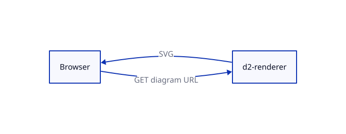

# d2-renderer: render D2 diagrams to SVG over HTTP

`d2-renderer` is a lightweight, zero-dependency HTTP microservice that compiles [D2](https://d2lang.com) diagram text into SVG. It runs across three operational footprints—as a prebuilt **Docker container**, a bare-metal **native Python server**, or a serverless service on **Google Cloud Run**—accepting Kroki-compatible GET URLs and POST payloads.



<!-- d2-source: examples/hello.d2 -->
<details>
<summary>D2 source</summary>

```d2
vars: {
  d2-config: {
    layout-engine: dagre
  }
}
direction: right
Browser -> d2-renderer: GET diagram URL
d2-renderer -> Browser: SVG
```

</details>

---

## Why D2 & Why This Service Exists

[Mermaid](https://mermaid.js.org/) is widely adopted because GitHub and GitLab render it natively. However, teams frequently hit Mermaid's limits when modeling complex software architecture: nested scoping is awkward, layout engines cannot be customized, and large topology diagrams quickly become tangled.

**D2 is engineered specifically for software and systems architecture.** It provides native nested containers, multiple layout engines (Dagre, ELK, TALA), SQL schema tables, sequence lifelines, and hand-drawn sketch styles.

Yet D2 faces an **adoption friction**:
1. GitHub, GitLab, and Markdown viewers render `d2` code blocks as raw text.
2. Public cloud renderers (such as public Kroki instances) require sending sensitive architecture notes over the public internet.
3. Managing local CLI binaries, layout engines, and font packages across different operating systems introduces team friction.

`d2-renderer` eliminates this barrier: a private, secure microservice you control that compiles diagrams offline and serves them over standard HTTP.

---

## The D2 Authoring Ecosystem

`d2-renderer` serves as the rendering backbone for an integrated suite of tools designed to make D2 authoring effortless:

```
┌────────────────────────────────────────────────────────┐
│             d2-architect (AI Agent Skill)              │
│   Designs & validates checked D2 architecture diagrams │
└───────────────────────────┬────────────────────────────┘
                            │ writes d2 code
                            ▼
┌────────────────────────────────────────────────────────┐
│     Lightweight Markdown Preview (VS Code Extension)   │
│   Draws d2 fences live as you type in Markdown preview │
└───────────────────────────┬────────────────────────────┘
                            │ HTTP POST / GET
                            ▼
┌────────────────────────────────────────────────────────┐
│              d2-renderer (This Microservice)           │
│   Compiles D2 to SVG offline in temporary sandbox      │
└────────────────────────────────────────────────────────┘
```

| Component | Responsibility | Links |
| :--- | :--- | :--- |
| **d2-renderer** (This Service) | The engine: converts D2 text to SVG via standard HTTP with offline isolation. | [Setup Guide](./docs/setup/README.md) |
| **[Lightweight Markdown Preview](https://github.com/kanad13/lightweight-markdown-preview)** | The canvas: fast VS Code extension that renders D2 fences live as you type. | [VS Code Marketplace](https://marketplace.visualstudio.com/items?itemName=KunalPathak.lightweight-markdown-preview) · [Open VSX](https://open-vsx.org/extension/KunalPathak/lightweight-markdown-preview) |
| **[d2-architect](https://github.com/kanad13/coherent-output/tree/main/skills/d2-architect)** | The author: agent skill that adds checked, TALA-laid-out D2 diagrams to documentation. | [GitHub Repository](https://github.com/kanad13/coherent-output/tree/main/skills/d2-architect) |

---

## Three Operational Footprints

Run `d2-renderer` in whatever way matches your infrastructure and security constraints:

| Footprint | When to Choose | Key Characteristics | Setup Guide |
| :--- | :--- | :--- | :--- |
| **Docker Container** | You have Docker or Podman installed. | Zero local toolchain install; bundles D2 compiler, layout engines, and fonts; multi-arch (`amd64`/`arm64`). | [Docker Runbook](./docs/setup/010-docker.md) |
| **Native Python** | You want zero container overhead or Docker is restricted. | Python standard library only; zero `pip` packages; instant startup; executes local `d2` binary safely. | [Native Python Runbook](./docs/setup/020-local-python.md) |
| **Google Cloud Run** | You want a shared team service or public `` URLs. | Serverless scale-to-zero; free-tier friendly; keyless OIDC GitHub deployment; 1-command public IAM toggle. | [Cloud Run Runbook](./docs/setup/030-cloud-run.md) |

Every footprint provides the exact same HTTP contract. A client configured to talk to `http://localhost:8088` can switch to a Cloud Run URL with zero code changes.

---

## Universal HTTP Contract (10-Second Taste)

Once your renderer is running, POST raw D2 script to `/d2/svg`:

```bash
printf 'client -> server: request\nserver -> client: response' \
  | curl -X POST --data-binary @- http://localhost:8088/d2/svg -o hello.svg
```

Or reference a GET URL in Markdown or HTML:

```markdown

```

See the [API Reference](./docs/020-api-reference.md) for full parameter support (`?sketch=true`, `?theme=<id>`, `?layout=dagre|elk|tala`).

---

## Visual Gallery & Live Verification

- **Browse What D2 Can Draw:** The [Visualization Gallery](./docs/visualizations/README.md) showcases full architecture topologies, database schemas, sequence diagrams, and CI/CD pipelines drawn with D2.
- **Verify Your Setup:** Open [test-preview.md](./docs/visualizations/test-preview.md) in VS Code with [Lightweight Markdown Preview](https://marketplace.visualstudio.com/items?itemName=KunalPathak.lightweight-markdown-preview) to verify that unrendered code fences convert to live interactive SVGs.

---

## Core Features & Safety Invariants

| Feature | Mechanism | Benefit |
| :--- | :--- | :--- |
| **Private Rendering** | Compiles locally inside your container or host process | Architecture designs never leave your control. |
| **Offline Compiles** | Runs `d2 --bundle=false` in an empty temporary directory | Diagrams cannot fetch external icon URLs or import server files. See [decision 060](./docs/decisions/060-offline-compile-in-empty-directory.md). |
| **Zero Dependencies** | Server uses only Python standard library | Single clean file; zero pip vulnerability management. |
| **Multi-Architecture** | Multi-arch image manifests (`linux/amd64`, `linux/arm64`) | Runs natively on Intel/AMD and Apple Silicon without emulation. |
| **In-Memory Cache** | Least-recently-used (LRU) memory cache (256 entries) | Repeated requests resolve in ~1.2 ms without spawning processes. |
| **Readable Errors** | One-line RFC status with full plain-text compiler diagnostics | Strict HTTP clients (e.g. Node's `fetch`) parse errors without crashing. |
| **Bounded Resources** | Caps input size (256 KiB), compile time (20s), and instances | Protects public instances from memory and CPU exhaustion. |

---

## Security and Privacy

Because `d2-renderer` can run as an open public microservice, it treats all diagram text as untrusted input across all environments.

| Risk Surface | Defense Mechanism |
| :--- | :--- |
| **Icon URLs and SSRF** | Compiles with `--bundle=false`. Diagram icon URLs remain un-fetched `<image href>` references. |
| **Local File Inclusion** | Compiles in an ephemeral empty directory; imports (`...@path`) find no host files. |
| **Decompression Bombs** | Rejects payloads exceeding `MAX_SOURCE_BYTES` (256 KiB) both raw and after inflation (`413`). |
| **Runaway Renders** | Terminated after `RENDER_TIMEOUT_SECONDS` (20s) with `504 Gateway Timeout`. |
| **Process Privileges** | Docker image runs as dedicated non-root `appuser`. |
| **Secrets Management** | Zero secrets stored in repository. Cloud Run deploys use keyless GitHub OIDC federation. |

Review the [Security Policy](./SECURITY.md) for vulnerability reporting and security boundaries.

---

## Documentation

| Guide | Description |
| :--- | :--- |
| [**Deployment & Setup**](./docs/setup/README.md) | Setup guides for Docker, native Python, and Google Cloud Run. |
| [**Visualization Gallery**](./docs/visualizations/README.md) | Showcase of architecture diagrams, schemas, and styling options. |
| [**Render Verification**](./docs/visualizations/test-preview.md) | Unrendered Markdown document for verifying live editor preview. |
| [**API Reference**](./docs/020-api-reference.md) | Endpoints, query parameters, encoding formats, and status codes. |
| [**Architecture**](./docs/030-architecture.md) | System components, request flow diagrams, caching, and resource limits. |
| [**Operations**](./docs/050-operations.md) | Cost controls, rollback procedures, logging, and public access IAM toggles. |
| [**Decision Records**](./docs/decisions/README.md) | Architectural Decision Records (ADRs) explaining technical trade-offs. |
| [**Examples**](./examples/README.md) | Eight sample `.d2` files with rendered SVGs and curl commands. |
| [**Testing Guide**](./TESTING.md) | Integration test map, sabotage checks, and verification procedures. |
| [**AGENTS.md**](./AGENTS.md) | Repository instructions for coding agents. |

---

## License

[MIT](./LICENSE)
