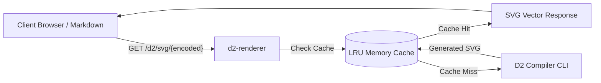

# d2-renderer

A lightweight, zero-dependency HTTP microservice and Docker container that turns [D2](https://d2lang.com) diagram code into SVG vector graphics on the fly. 

Designed for personal documentation hubs, blogs, and wikis where you want to embed diagrams via standard HTML `` tags or Markdown without installing compilers on client devices or sending private diagram data to third-party services.



---

## Features

- **Kroki-Compatible URLs:** Embed diagrams via `">`.
- **Zero Python Dependencies:** Built using Python's standard library (`http.server`, `urllib`, `subprocess`, `zlib`, `base64`).
- **High Performance:** In-memory LRU cache stores rendered SVGs; duplicate requests respond in `<1ms`.
- **Offline and private:** Every compile runs without network access, in an empty working directory. A diagram's icon URLs stay references in the SVG, so a public instance stays safe. See [decision 060](./docs/decisions/060-offline-compile-in-empty-directory.md).
- **Runs natively everywhere:** One image tag serves Intel/AMD (`linux/amd64`) and Apple Silicon or other Arm hosts (`linux/arm64`).
- **Well-formed errors:** Every error reply has a one-line status and a plain-text body with the full compiler message.
- **Customizable:** Query parameter support for hand-drawn sketch mode (`?sketch=true`) and themes (`?theme=<id>`).
- **Full Font Support:** Includes `fontconfig` and DejaVu TrueType fonts inside the container to ensure accurate text layout metrics.
- **REST POST Endpoint:** Accepts raw D2 text in request bodies for programmatic rendering.

---

## Use it with VS Code

Lightweight Markdown Preview draws your ```d2 fences with this service. Start the container, run **Markdown: Choose D2 Renderer** and pick the local Docker container.

- [Visual Studio Marketplace](https://marketplace.visualstudio.com/items?itemName=KunalPathak.lightweight-markdown-preview)
- [Open VSX](https://open-vsx.org/extension/KunalPathak/lightweight-markdown-preview)
- [GitHub](https://github.com/kanad13/lightweight-markdown-preview)
- [D2 guide](https://github.com/kanad13/lightweight-markdown-preview/blob/main/docs/d2.md)

---

## Repository Map

| Directory / File | Description |
| :--- | :--- |
| [server.py](./server.py) | Main HTTP microservice daemon with caching and CLI invocation. |
| [Dockerfile](./Dockerfile) | Multi-stage Docker build producing the production container image. |
| [TESTING.md](./TESTING.md) | Canonical testing strategy and behavioral verification instructions. |
| [examples/](./examples/README.md) | Sample `.d2` source files and pre-encoded URL strings. |
| [tests/](./tests/test_server.py) | Automated integration test suite. |
| [.github/workflows/ci.yml](./.github/workflows/ci.yml) | GitHub Actions: test, publish to GHCR, deploy to Cloud Run. |
| [scripts/](./scripts/gcp-setup.sh) | One-time GCP setup script and the visual render check. |
| [docs/](./docs/README.md) | Architecture, deploy runbook, operations, plan and decision records. |
| [AGENTS.md](./AGENTS.md) | Instructions for coding agents, including the per-session goal. |

---

## Quickstart

### 1. Run with Docker (Recommended)

```bash
docker run -d --name d2-renderer -p 8080:8080 ghcr.io/kanad13/d2-renderer:latest
```

Verify the health check:

```bash
curl http://localhost:8080/health
```

To build the image from this repository instead: `docker build -t d2-renderer .`, then run `d2-renderer` in place of the `ghcr.io` name above.

### 2. Run Natively (Bare Metal)

If you have `d2` installed locally (`brew install d2` or `curl -fsSL https://d2lang.com/install.sh | sh`):

```bash
python3 server.py
```

The service will start on `http://localhost:8080`.

---

## API Specification

### 1. `GET /d2/svg/<encoded_string>`

Renders an SVG from a zlib-compressed, URL-safe Base64 encoded string.

#### Parameters (Query String)
| Parameter | Type | Default | Description |
| :--- | :--- | :--- | :--- |
| `sketch` | boolean | `false` | When `true`, renders diagram with a hand-drawn sketch aesthetic. |
| `theme` | string / integer | `0` | D2 theme ID (e.g. `0` default, `1` neutral grey, `200` dark mauve). |
| `layout` | string | `dagre` | Layout engine to use (`dagre`, `elk`, `tala`). |

#### Example Usage

Source:

```d2
direction: right
Browser -> d2-renderer: GET diagram URL
d2-renderer -> Browser: SVG
```

Embed (the encoder under [Client-Side URL Encoding](#client-side-url-encoding) produced this string from the source above):

```html

```

---

### 2. `POST /d2/svg`

Renders an SVG from raw D2 code passed in the HTTP request body.

#### Example Request
```bash
curl -X POST http://localhost:8080/d2/svg \
  -H "Content-Type: text/plain" \
  -d "User -> Service: Call API"
```

---

### 3. `GET /health`

Health check probe for container orchestrators (e.g., Cloud Run, Kubernetes, Docker). Returns `200 OK` with body `OK`.

### Error responses

Every error reply carries a one-line status (`Bad Request`, `Not Found`, `Payload Too Large`, `Gateway Timeout`) and the full message in a `text/plain; charset=utf-8` body, so strict HTTP clients such as Node's `fetch` read it directly.

| Status | Meaning |
| :--- | :--- |
| `400` | Malformed payload or D2 syntax error. The body is `text/plain` and holds the compiler message. |
| `413` | Input larger than `MAX_SOURCE_BYTES` (default 256 KiB), raw or decompressed. |
| `504` | Render exceeded `RENDER_TIMEOUT_SECONDS` (default 20). |

---

## Client-Side URL Encoding

To generate the `{encoded_string}` from a D2 diagram file, use any of these one-liners:

### Python
```bash
python3 -c "import sys, base64, zlib; print(base64.urlsafe_b64encode(zlib.compress(sys.stdin.read().encode('utf-8'), 9)).decode('ascii'))" < diagram.d2
```

### Node.js / JavaScript
```javascript
const zlib = require('zlib');

function encodeD2(code) {
  const compressed = zlib.deflateSync(Buffer.from(code, 'utf-8'), { level: 9 });
  return compressed.toString('base64').replace(/\+/g, '-').replace(/\//g, '_');
}
```

---

## Cloud Deployment

The service is stateless and runs on Google Cloud Run in an EU region, scaling to zero when idle. Pushes to `main` test, publish and deploy automatically.

- **Set up your own copy:** follow the [GCP deploy runbook](./docs/020-deploy-gcp.md).
- **Run and tune it:** see [operations](./docs/030-operations.md) for cost, rollback and limits.
- **Why it is built this way:** see the [decision records](./docs/decisions/README.md).

Other hosts work too, since it is a plain container:

```bash
# Fly.io
fly launch --image ghcr.io/kanad13/d2-renderer:latest

# Any Docker host
docker run -d --name d2-renderer -p 80:8080 --restart unless-stopped ghcr.io/kanad13/d2-renderer:latest
```

Keep a public service safe with the limits in [architecture](./docs/010-architecture.md#limits-and-why-they-exist): input size, render time and instance caps are enforced by default.

---

## Verification & Testing

Refer to [TESTING.md](./TESTING.md) for the complete test strategy and automated test harness execution instructions.

```bash
python3 -m unittest discover -s tests -v
```

---

## License

MIT
