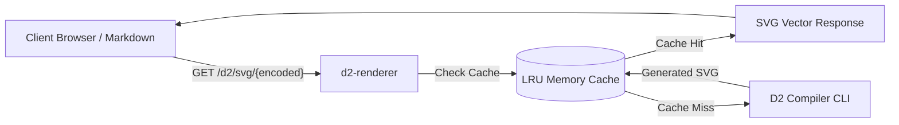

# d2-renderer

A lightweight, zero-dependency HTTP microservice and Docker container that turns [D2](https://d2lang.com) diagram code into SVG vector graphics on the fly. 

Designed for personal documentation hubs, blogs, and wikis where you want to embed diagrams via standard HTML `` tags or Markdown without installing compilers on client devices or sending private diagram data to third-party services.



---

## Features

- **Kroki-Compatible URLs:** Embed diagrams via `">`.
- **Zero Python Dependencies:** Built using Python's standard library (`http.server`, `urllib`, `subprocess`, `zlib`, `base64`).
- **High Performance:** In-memory LRU cache stores rendered SVGs; duplicate requests respond in `<1ms`.
- **Customizable:** Query parameter support for hand-drawn sketch mode (`?sketch=true`) and themes (`?theme=<id>`).
- **Full Font Support:** Includes `fontconfig` and DejaVu TrueType fonts inside the container to ensure accurate text layout metrics.
- **REST POST Endpoint:** Accepts raw D2 text in request bodies for programmatic rendering.

---

## Repository Map

| Directory / File | Description |
| :--- | :--- |
| [server.py](./server.py) | Main HTTP microservice daemon with caching and CLI invocation. |
| [Dockerfile](./Dockerfile) | Multi-stage Docker build producing the production container image. |
| [TESTING.md](./TESTING.md) | Canonical testing strategy and behavioral verification instructions. |
| [examples/](./examples/README.md) | Sample `.d2` source files and pre-encoded URL strings. |
| [tests/](./tests/test_server.py) | Automated integration test suite. |
| [.github/workflows/ci.yml](./.github/workflows/ci.yml) | GitHub Actions CI/CD workflow for testing and image publishing. |

---

## Quickstart

### 1. Run with Docker (Recommended)

```bash
# Build the image locally
docker build -t d2-renderer .

# Start the container
docker run -d -p 8080:8080 --name d2-renderer d2-renderer

# Verify the health check
curl http://localhost:8080/health
```

### 2. Run Natively (Bare Metal)

If you have `d2` installed locally (`brew install d2` or `curl -fsSL https://d2lang.com/install.sh | sh`):

```bash
python3 server.py
```

The service will start on `http://localhost:8080`.

---

## API Specification

### 1. `GET /d2/svg/<encoded_string>`

Renders an SVG from a zlib-compressed, URL-safe Base64 encoded string.

#### Parameters (Query String)
| Parameter | Type | Default | Description |
| :--- | :--- | :--- | :--- |
| `sketch` | boolean | `false` | When `true`, renders diagram with a hand-drawn sketch aesthetic. |
| `theme` | string / integer | `0` | D2 theme ID (e.g. `0` default, `1` neutral grey, `200` dark mauve). |
| `layout` | string | `dagre` | Layout engine to use (`dagre`, `elk`, `tala`). |

#### Example Usage
```html

```

---

### 2. `POST /d2/svg`

Renders an SVG from raw D2 code passed in the HTTP request body.

#### Example Request
```bash
curl -X POST http://localhost:8080/d2/svg \
  -H "Content-Type: text/plain" \
  -d "User -> Service: Call API"
```

---

### 3. `GET /health`

Health check probe for container orchestrators (e.g., Cloud Run, Kubernetes, Docker). Returns `200 OK` with body `OK`.

---

## Client-Side URL Encoding

To generate the `{encoded_string}` from a D2 diagram file, use any of these one-liners:

### Python
```bash
python3 -c "import sys, base64, zlib; print(base64.urlsafe_b64encode(zlib.compress(sys.stdin.read().encode('utf-8'), 9)).decode('ascii'))" < diagram.d2
```

### Node.js / JavaScript
```javascript
const zlib = require('zlib');

function encodeD2(code) {
  const compressed = zlib.deflateSync(Buffer.from(code, 'utf-8'), { level: 9 });
  return compressed.toString('base64').replace(/\+/g, '-').replace(/\//g, '_');
}
```

---

## Cloud Deployment

Because this microservice is stateless and lightweight, it runs efficiently on low-cost or free-tier cloud containers:

### Option A: Google Cloud Run (Recommended for Personal Use)
Google Cloud Run scales down to **zero instances** when not in use, making it virtually free under the standard free tier (2 million requests/month):

```bash
gcloud run deploy d2-renderer \
  --image ghcr.io/kanad13/d2-renderer:latest \
  --platform managed \
  --region us-central1 \
  --allow-unauthenticated \
  --port 8080
```

### Option B: Fly.io
```bash
fly launch --image ghcr.io/kanad13/d2-renderer:latest
```

### Option C: Personal VPS / Docker Host
```bash
docker run -d --name d2-renderer \
  -p 80:8080 \
  --restart unless-stopped \
  ghcr.io/kanad13/d2-renderer:latest
```

---

## Verification & Testing

Refer to [TESTING.md](./TESTING.md) for the complete test strategy and automated test harness execution instructions.

```bash
python3 -m unittest discover -s tests -v
```

---

## License

MIT
