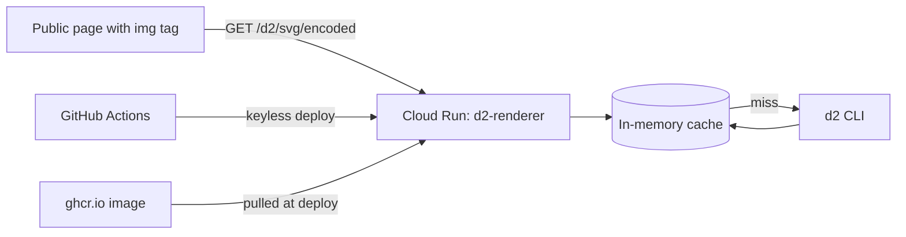

# Architecture

## The whole picture

`d2-renderer` is one small container. A request carries D2 diagram text; the service runs the `d2` command-line compiler and returns SVG. Diagram URLs are embedded in public pages, so the service is open to the internet and protects itself with limits instead of passwords.

## Components

| Part              | Role                                                                                   | Where                                    |
| :---------------- | :------------------------------------------------------------------------------------- | :--------------------------------------- |
| HTTP service      | Decodes the request, enforces limits, calls D2, caches results. Standard library only. | [server.py](../server.py)                |
| Container         | Python 3.12 plus a pinned D2 binary and fonts.                                         | [Dockerfile](../Dockerfile)              |
| CI/CD             | Test, publish to GitHub Container Registry, deploy to Cloud Run.                       | [ci.yml](../.github/workflows/ci.yml)    |
| Cloud Run service | Runs the container in an EU region, scales to zero.                                    | [020-deploy-gcp.md](./020-deploy-gcp.md) |

## Request flow

1. The client sends `GET /d2/svg/<payload>` (deflate + URL-safe base64) or `POST /d2/svg` with raw text.
2. The service rejects oversized input before any work: bodies and decompressed payloads above `MAX_SOURCE_BYTES` get `413`.
3. A cache hit returns immediately. A miss runs `d2` offline (`--bundle=false`) in an empty temporary directory, with a time limit ([decision 060](./decisions/060-offline-compile-in-empty-directory.md)); exceeding `RENDER_TIMEOUT_SECONDS` gives `504`, D2 syntax errors give `400`.
4. The SVG is returned with a one-year cache header, so browsers rarely ask twice.

## Limits and why they exist

| Setting                  | Default     | Protects against                                      |
| :----------------------- | :---------- | :---------------------------------------------------- |
| `MAX_SOURCE_BYTES`       | 256 KiB     | Memory exhaustion by huge or highly compressed input. |
| `RENDER_TIMEOUT_SECONDS` | 20          | A stuck compile holding an instance forever.          |
| Cache size               | 256 entries | Cache growth filling a 512 MiB instance.              |
| Cloud Run concurrency    | 8           | Many parallel D2 processes on one CPU.                |
| Cloud Run max instances  | 1           | Cost growth under a traffic flood.                    |

Cloud Run settings are applied by the deploy job in [ci.yml](../.github/workflows/ci.yml). The reasoning is in [decision 050](./decisions/050-traffic-limits-and-cost-guardrails.md).

## Navigation

- [Documentation index](./README.md)
- Next: [Deploy runbook](./020-deploy-gcp.md)
