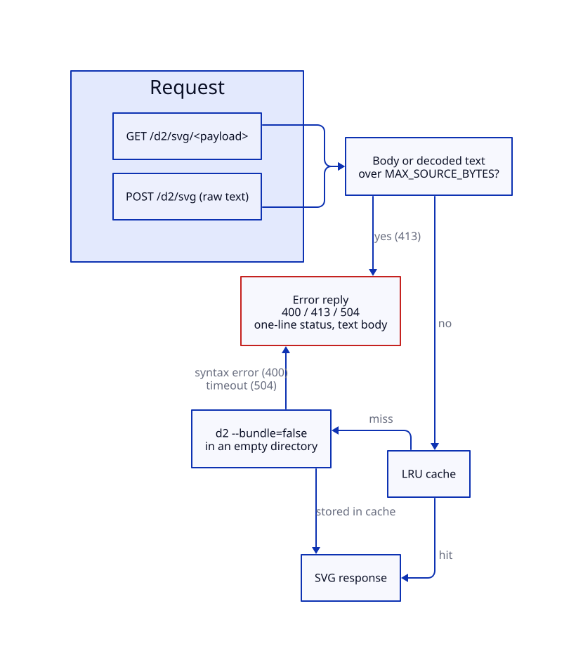
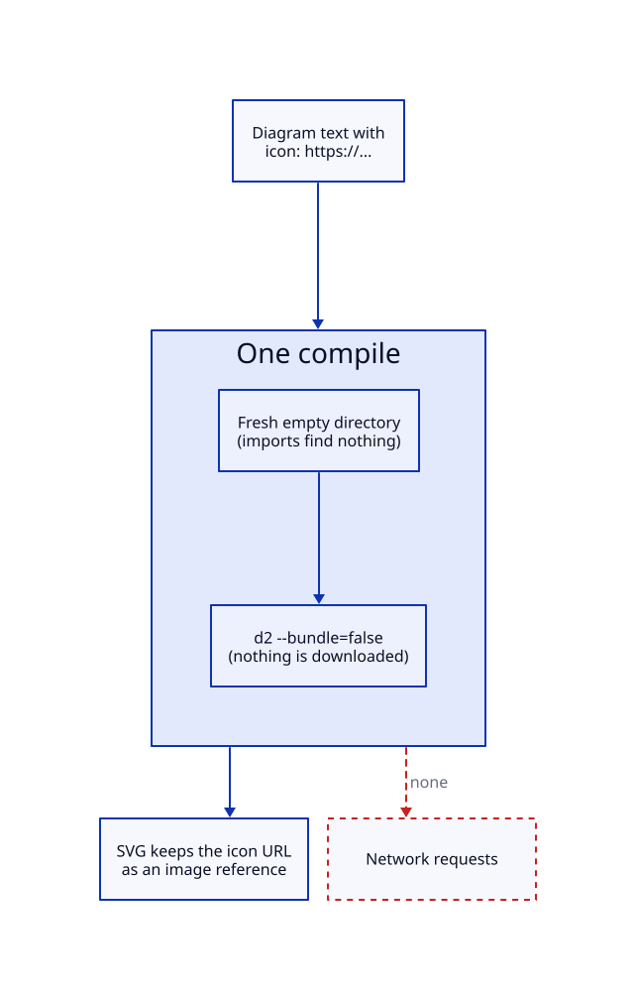
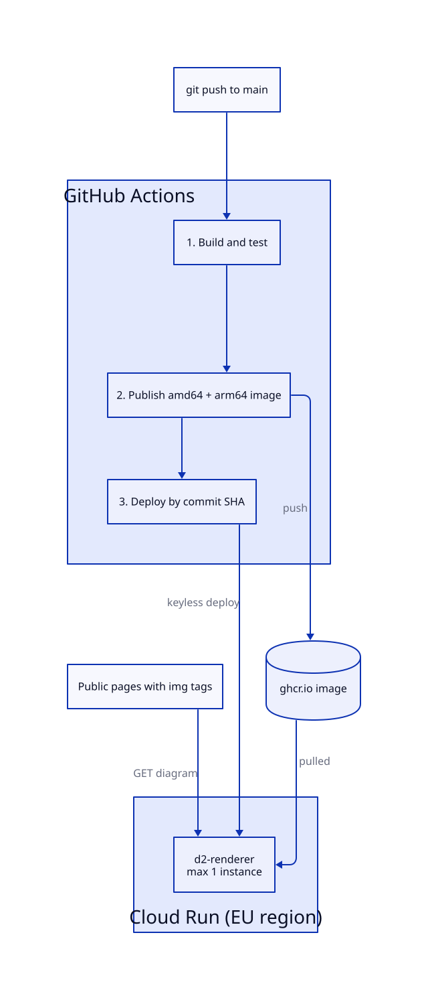

# Architecture

d2-renderer is one small container: an HTTP service that runs the `d2` compiler and returns SVG. The same image runs on your laptop and on Google Cloud Run. Because public pages embed diagram URLs, a public instance is open to the internet and protects itself with limits instead of passwords ([decision 020](./decisions/020-no-token-auth.md)).

## Components

| Part              | Role                                                                                           | Where                                 |
| :---------------- | :--------------------------------------------------------------------------------------------- | :------------------------------------ |
| HTTP service      | Decodes the request, enforces limits, calls D2, caches results. Standard library only.         | [server.py](../server.py)             |
| Container         | Python 3.12, a pinned D2 binary (v0.9.0) and fonts, built for `linux/amd64` and `linux/arm64`. | [Dockerfile](../Dockerfile)           |
| CI/CD             | Test, publish a multi-architecture image to GitHub Container Registry, deploy to Cloud Run.    | [ci.yml](../.github/workflows/ci.yml) |
| Cloud Run service | Runs the container in an EU region and scales to zero.                                         | [Deploy runbook](./040-deploy-gcp.md) |

## Request flow

A request carries D2 text. The service rejects oversized input first, then answers from the cache or compiles the text.



<!-- d2-source: docs/diagrams/request-flow.d2 -->
<details>
<summary>D2 source</summary>

```d2
direction: down

req: Request {
  get: "GET /d2/svg/<payload>"
  post: "POST /d2/svg (raw text)"
}

limits: Size check {
  label: "Body or decoded text\nover MAX_SOURCE_BYTES?"
}
cache: LRU cache
compile: "d2 --bundle=false\nin an empty directory"
reply: SVG response
errors: "Error reply\n400 / 413 / 504\none-line status, text body" {
  style.stroke: "#C5221F"
}

req.get -> limits
req.post -> limits
limits -> errors: yes (413)
limits -> cache: no
cache -> reply: hit
cache -> compile: miss
compile -> reply: stored in cache
compile -> errors: syntax error (400)\ntimeout (504)
```

</details>

- **Step 1, the request:**
  - The client sends `GET /d2/svg/<payload>` (deflate plus URL-safe Base64) or `POST /d2/svg` with raw text.
- **Step 2, the size check:**
  - Bodies and decompressed payloads above `MAX_SOURCE_BYTES` get `413` before any work starts.
- **Step 3, the cache:**
  - A hit returns at once.
  - A miss runs `d2` with a time limit. A syntax error gives `400`, and exceeding `RENDER_TIMEOUT_SECONDS` gives `504`.
- **Step 4, the reply:**
  - The SVG carries a one-year cache header, so browsers rarely ask twice.
  - Every error reply has a one-line status and a plain-text body ([API reference](./020-api-reference.md#errors)).

## Offline compile

D2 normally downloads every icon and image URL a diagram names, and it resolves imports against the working directory. On an open service that would let a diagram make the container request any address, or read files beside the server. A measured probe against an earlier deployment reached the Cloud Run metadata server this way.



<!-- d2-source: docs/diagrams/offline-compile.d2 -->
<details>
<summary>D2 source</summary>

```d2
direction: down

diagram: "Diagram text with\nicon: https://..."
compile: "One compile" {
  direction: down
  tmp: "Fresh empty directory\n(imports find nothing)"
  flag: "d2 --bundle=false\n(nothing is downloaded)"
  tmp -> flag
}
svg: "SVG keeps the icon URL\nas an image reference"
net: "Network requests" {
  style.stroke: "#C5221F"
  style.stroke-dash: 3
}

diagram -> compile
compile -> svg
compile -> net: none {
  style.stroke: "#C5221F"
  style.stroke-dash: 3
}
```

</details>

- **Flag:** `d2 --bundle=false` makes the compiler offline. Icon URLs stay in the SVG as `<image href>` references.
- **Directory:** each compile runs in a fresh empty temporary directory, so imports find nothing.
- **Result:** a diagram cannot trigger an outbound request, on any host that runs the image.
- **Record:** [decision 060](./decisions/060-offline-compile-in-empty-directory.md).

## Build and deployment

Pushing to `main` tests the build, publishes both architectures, and deploys the commit to Cloud Run. Cloud Run selects the `linux/amd64` entry of the image.



<!-- d2-source: docs/diagrams/deployment.d2 -->
<details>
<summary>D2 source</summary>

```d2
direction: down

dev: "git push to main"

gha: GitHub Actions {
  direction: down
  test: "1. Build and test"
  publish: "2. Publish amd64 + arm64 image"
  deploy: "3. Deploy by commit SHA"
  test -> publish -> deploy
}

ghcr: ghcr.io image {
  shape: cylinder
}

run: Cloud Run (EU region) {
  svc: "d2-renderer\nmax 1 instance"
}

pages: Public pages with img tags

dev -> gha.test
gha.publish -> ghcr: push
gha.deploy -> run.svc: keyless deploy
ghcr -> run.svc: pulled
pages -> run.svc: GET diagram
```

</details>

## Limits and why they exist

| Setting                  | Default     | Protects against                                      |
| :----------------------- | :---------- | :---------------------------------------------------- |
| `MAX_SOURCE_BYTES`       | 256 KiB     | Memory exhaustion by huge or highly compressed input. |
| `RENDER_TIMEOUT_SECONDS` | 20          | A stuck compile holding an instance forever.          |
| Cache size               | 256 entries | Cache growth filling a 512 MiB instance.              |
| Cloud Run concurrency    | 8           | Many parallel D2 processes on one CPU.                |
| Cloud Run max instances  | 1           | Cost growth under a traffic flood.                    |

Cloud Run settings come from the deploy job in [ci.yml](../.github/workflows/ci.yml). The reasoning is in [decision 050](./decisions/050-traffic-limits-and-cost-guardrails.md).

## Where the diagrams in these docs come from

Each picture is an SVG that this project's own container drew from the D2 source shown beside it. `scripts/build-doc-diagrams.py` rebuilds them, and its `--check` mode runs in CI. See [decision 070](./decisions/070-static-svg-diagrams-in-docs.md).

## Navigation

- [Documentation index](./README.md)
- Previous: [API reference](./020-api-reference.md) · Next: [Deploy runbook](./040-deploy-gcp.md)
