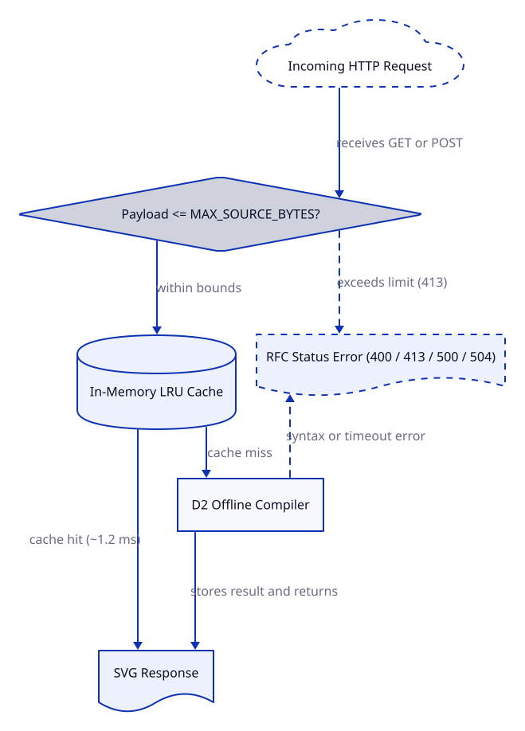
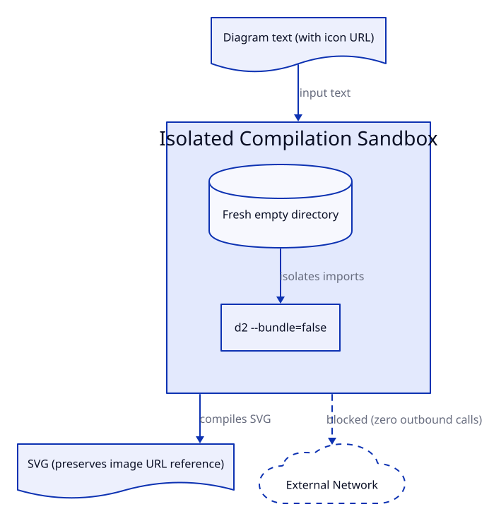
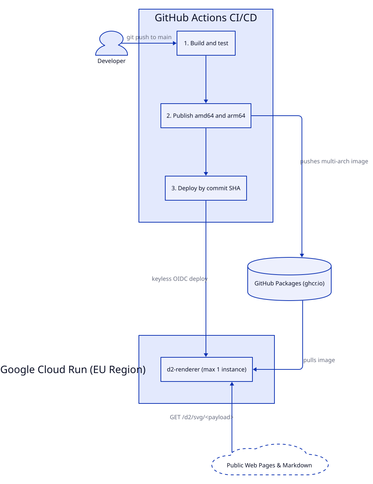

# Architecture

`d2-renderer` is an open-source HTTP service that compiles D2 diagram specifications into SVG images. The container runs on local developer machines, within self-hosted Docker environments, or as a serverless instance on Google Cloud Run. Because public pages embed diagram URLs directly, public instances operate without token authentication ([decision 020](./060-decisions/020-no-token-auth.md)) and enforce strict resource limits instead.

## Components

| Part              | Role                                                                                           | Where                                 |
| :---------------- | :--------------------------------------------------------------------------------------------- | :------------------------------------ |
| HTTP service      | Decodes the request, enforces limits, calls D2, caches results. Standard library only.         | [server.py](../server.py)             |
| Container         | Python 3.12, a pinned D2 binary (v0.9.0) and fonts, built for `linux/amd64` and `linux/arm64`. | [Dockerfile](../Dockerfile)           |
| CI/CD             | Test, publish a multi-architecture image to GitHub Container Registry, deploy to Cloud Run.    | [ci.yml](../.github/workflows/ci.yml) |
| Cloud Run service | Runs the container in an EU region and scales to zero.                                         | [Deploy runbook](./010-setup/030-cloud-run.md) |

## Request flow

A request carries D2 text. The service rejects oversized input first, then answers from the cache or compiles the text.



<!-- d2-source: docs/070-diagrams/request-flow.d2 -->
<details>
<summary>D2 source</summary>

```d2
vars: {
  d2-config: {
    layout-engine: tala
    pad: 24
    theme-id: 0
    dark-theme-id: 200
  }
}

client_request: Incoming HTTP Request {
  shape: cloud
  style.stroke-dash: 4
}

size_guard: "Payload <= MAX_SOURCE_BYTES?" {
  shape: diamond
}

memory_cache: In-Memory LRU Cache {
  shape: cylinder
}

compiler_engine: "D2 Offline Compiler"
svg_response: SVG Response {
  shape: document
}

error_response: "RFC Status Error (400 / 413 / 500 / 504)" {
  shape: document
  style.stroke-dash: 4
}

client_request -> size_guard: receives GET or POST
size_guard -> error_response: "exceeds limit (413)" {
  style.stroke-dash: 4
}
size_guard -> memory_cache: within bounds
memory_cache -> svg_response: cache hit (~1.2 ms)
memory_cache -> compiler_engine: cache miss
compiler_engine -> svg_response: stores result and returns
compiler_engine -> error_response: syntax or timeout error {
  style.stroke-dash: 4
}
```

</details>

- **Step 1, the request:**
  - The client sends `GET /d2/svg/<payload>` (deflate plus URL-safe Base64) or `POST /d2/svg` with raw text.
- **Step 2, the size check:**
  - Bodies and decompressed payloads above `MAX_SOURCE_BYTES` get `413` before any work starts.
- **Step 3, the cache:**
  - A hit returns at once.
  - A miss runs `d2` with a time limit. A syntax error gives `400`, a missing compiler binary gives `500`, and exceeding `RENDER_TIMEOUT_SECONDS` gives `504`.
- **Step 4, the reply:**
  - The SVG carries a one-year cache header, so browsers rarely ask twice.
  - Every error reply has a one-line status and a plain-text body ([API reference](./020-api-reference.md#errors)).

## Offline compile

D2 normally downloads every icon and image URL a diagram names, and it resolves imports against the working directory. On an open service that would let a diagram make the container request any address, or read files beside the server. A measured probe against an earlier deployment reached the Cloud Run metadata server this way.



<!-- d2-source: docs/070-diagrams/offline-compile.d2 -->
<details>
<summary>D2 source</summary>

```d2
vars: {
  d2-config: {
    layout-engine: tala
    pad: 24
    theme-id: 0
    dark-theme-id: 200
  }
}

source_text: "Diagram text (with icon URL)" {
  shape: document
}

compile_sandbox: Isolated Compilation Sandbox {
  empty_dir: "Fresh empty directory" {
    shape: cylinder
  }
  offline_flag: "d2 --bundle=false"
  empty_dir -> offline_flag: isolates imports
}

rendered_svg: "SVG (preserves image URL reference)" {
  shape: document
}

external_network: External Network {
  shape: cloud
  style.stroke-dash: 4
}

source_text -> compile_sandbox: input text
compile_sandbox -> rendered_svg: compiles SVG
compile_sandbox -> external_network: blocked (zero outbound calls) {
  style.stroke-dash: 4
}
```

</details>

- **Flag:** `d2 --bundle=false` makes the compiler offline. Icon URLs stay in the SVG as `<image href>` references.
- **Directory:** each compile runs in a fresh empty temporary directory, so imports find nothing.
- **Result:** a diagram cannot trigger an outbound request, on any host that runs the image.
- **Record:** [decision 060](./060-decisions/060-offline-compile-in-empty-directory.md).

## Build and deployment

Pushing to `main` tests the build and publishes both architectures to GHCR. Cloud Run deployment runs on manual dispatch ([decision 090](./060-decisions/090-on-demand-cloud-run-deployment.md)), selecting the `linux/amd64` entry of the image.



<!-- d2-source: docs/070-diagrams/deployment.d2 -->
<details>
<summary>D2 source</summary>

```d2
vars: {
  d2-config: {
    layout-engine: tala
    pad: 24
    theme-id: 0
    dark-theme-id: 200
  }
}

developer: Developer {
  shape: person
}

github_actions: GitHub Actions CI/CD {
  test_job: "1. Build and test"
  publish_job: "2. Publish amd64 and arm64"
  deploy_job: "3. Deploy by commit SHA"
  test_job -> publish_job -> deploy_job
}

container_registry: "GitHub Packages (ghcr.io)" {
  shape: cylinder
}

cloud_run: Google Cloud Run (EU Region) {
  service: "d2-renderer (max 1 instance)"
}

public_clients: Public Web Pages & Markdown {
  shape: cloud
  style.stroke-dash: 4
}

developer -> github_actions.test_job: "git push to main"
github_actions.publish_job -> container_registry: pushes multi-arch image
github_actions.deploy_job -> cloud_run.service: keyless OIDC deploy
container_registry -> cloud_run.service: pulls image
public_clients -> cloud_run.service: "GET /d2/svg/<payload>"
```

</details>

## Limits and why they exist

| Setting                  | Default     | Protects against / Configures                         |
| :----------------------- | :---------- | :---------------------------------------------------- |
| `PORT`                   | 8088        | TCP listening port (overridden by Cloud Run or CLI).  |
| `HOST` / `--bind`        | `0.0.0.0`   | Network interface binding (set to `127.0.0.1` locally). |
| `MAX_SOURCE_BYTES`       | 256 KiB     | Memory exhaustion by huge or highly compressed input. |
| `RENDER_TIMEOUT_SECONDS` | 20          | A stuck compile holding an instance forever.          |
| Cache size (in-memory)   | 256 entries | Cache growth filling a 512 MiB instance.              |
| Cloud Run concurrency    | 8           | Many parallel D2 processes on one CPU.                |
| Cloud Run max instances  | 1           | Cost growth under a traffic flood.                    |

Cloud Run settings come from the deploy job in [ci.yml](../.github/workflows/ci.yml). The reasoning is in [decision 050](./060-decisions/050-traffic-limits-and-cost-guardrails.md).

## Where the diagrams in these docs come from

Each picture is an SVG that this project's own container drew from the D2 source shown beside it. `scripts/build-doc-diagrams.py` rebuilds them, and its `--check` mode runs in CI. See [decision 070](./060-decisions/070-static-svg-diagrams-in-docs.md).

## Navigation

- [Documentation index](./README.md)
- Previous: [API reference](./020-api-reference.md) · Next: [Operations](./050-operations.md)
