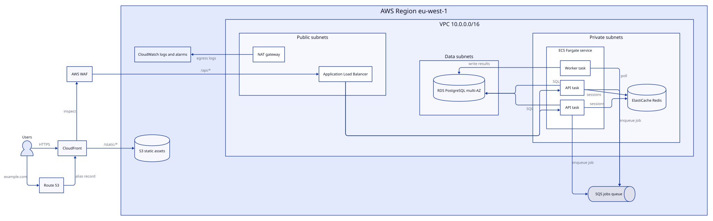
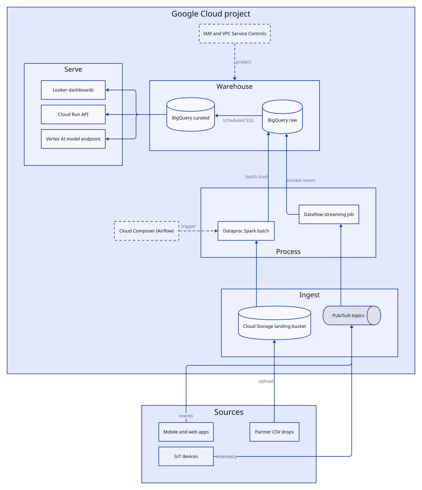
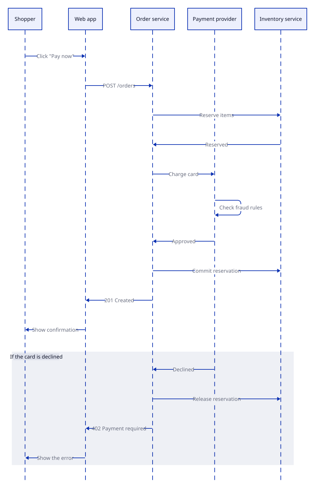
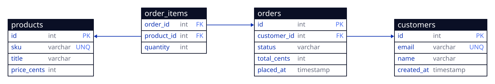
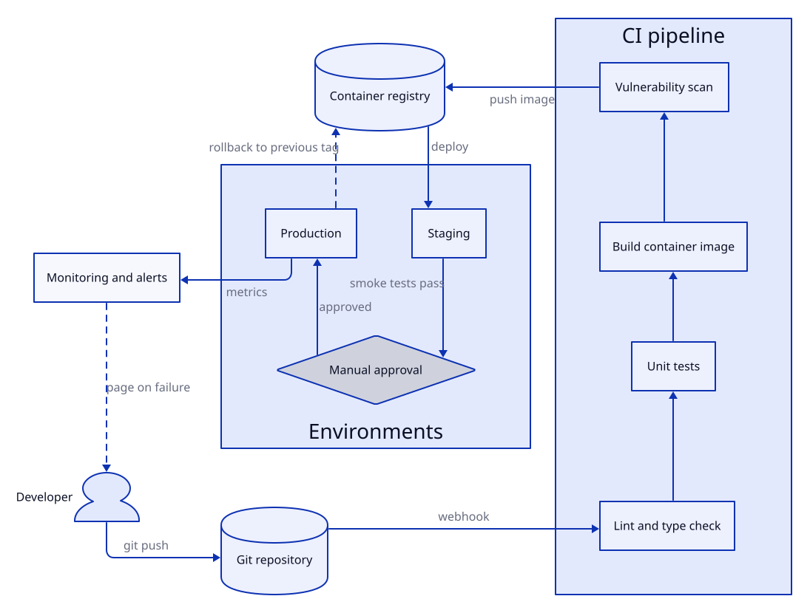
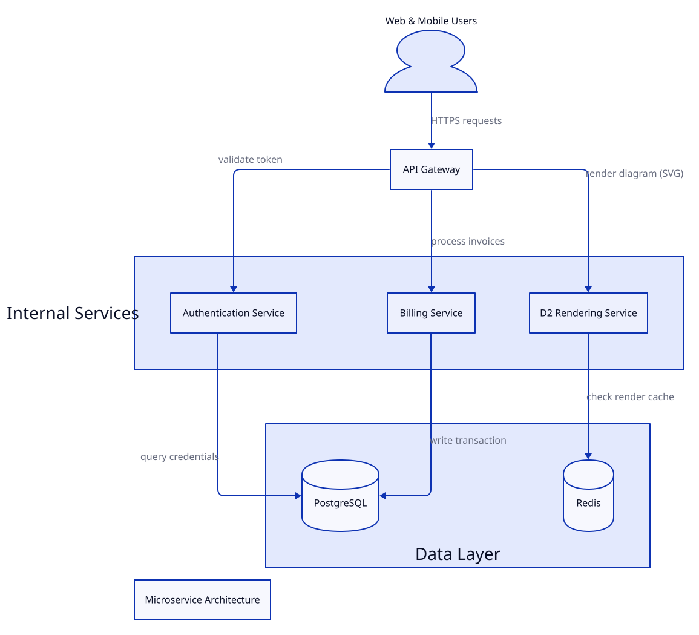

# D2 Visualization Gallery

## Purpose

A visual reference showcasing the expressive range of the [D2 declarative diagramming language](https://d2lang.com). Unlike generic flowchart tools, D2 provides native primitives for software and system architecture: nested scoping, database schemas, multiple layout engines, sequence diagrams, and dark/sketch aesthetics.

Every diagram below is rendered directly by `d2-renderer`.

---

## Gallery

### 1. Cloud Infrastructure: AWS Multi-Tier Stack
Demonstrates nested VPC subnets, application load balancing, ECS Fargate services, and managed datastores (RDS, ElastiCache, SQS).
- **Source:** [aws-web-architecture.d2](../090-examples/aws-web-architecture.d2)
- **Engine:** TALA layout engine

---

### 2. Modern Data Platform: Google Cloud
Demonstrates data pipeline architecture, spanning orchestrators, streaming ingest (Pub/Sub), BigQuery warehouse modeling, and machine learning serving.
- **Source:** [gcp-data-platform.d2](../090-examples/gcp-data-platform.d2)
- **Engine:** TALA layout engine

---

### 3. Business Workflows: Checkout Sequence
Demonstrates sequence diagrams with actors, parallel verification, and grouped failure paths.
- **Source:** [checkout-sequence.d2](../090-examples/checkout-sequence.d2)
- **Type:** Sequence diagram

---

### 4. Data Modeling: Relational Database Schema
Demonstrates native `sql_table` shapes, primary keys, foreign keys, and relationship arrows.
- **Source:** [orders-schema.d2](../090-examples/orders-schema.d2)

---

### 5. DevOps: CI/CD Delivery Pipeline
Demonstrates multi-stage delivery pipelines with manual approval gates, automated tests, container scanning, and automated rollbacks.
- **Source:** [cicd-pipeline.d2](../090-examples/cicd-pipeline.d2)

---

### 6. Microservices Topology
Demonstrates tiered architectures with person actors, API gateways, decoupled microservices, and persistence layers.
- **Source:** [architecture.d2](../090-examples/architecture.d2)

---

## Verifying Your Renderer

To test these diagrams live in VS Code or via HTTP:
- Open [010-test-preview.md](./010-test-preview.md) to inspect unrendered `d2` fences in your editor.
- See the [Setup Guide](../010-setup/README.md) to configure your renderer.
