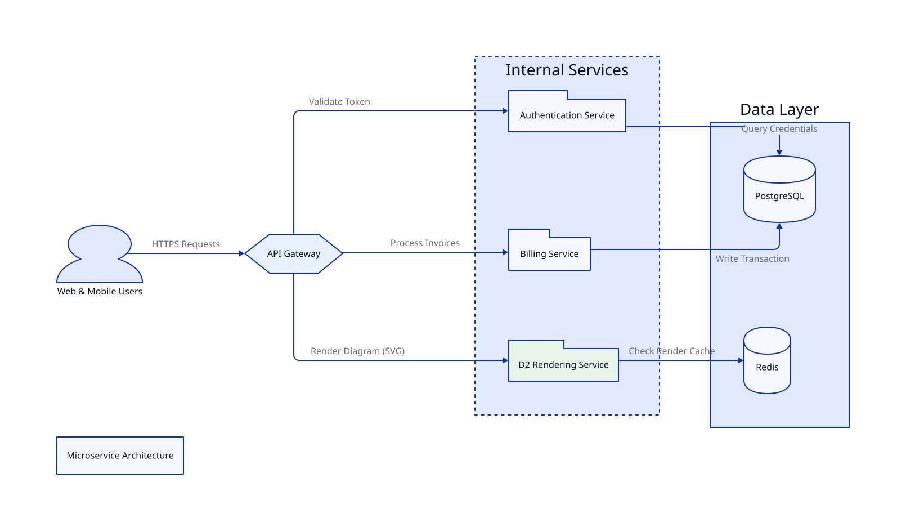
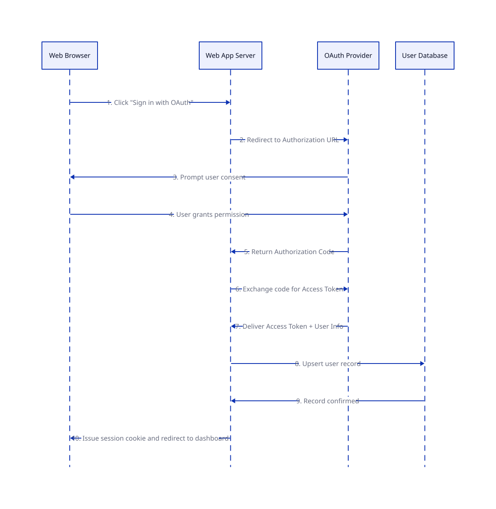

# Example diagrams

## Purpose

Eight ready-made D2 diagrams with the pictures that d2-renderer draws from them. Each picture is an SVG committed in [img/](./img/), so GitHub shows it without a running service. Open the **D2 source** block under a picture to copy the code behind it.

## Contents

| Source                                               | Picture                                                    | Shows                                                                                |
| :--------------------------------------------------- | :--------------------------------------------------------- | :----------------------------------------------------------------------------------- |
| [hello.d2](./hello.d2)                               | [hello.svg](./img/hello.svg)                               | The smallest useful diagram: two nodes and two labelled arrows.                      |
| [architecture.d2](./architecture.d2)                 | [architecture.svg](./img/architecture.svg)                 | A multi-tier service topology with containers, shapes, colours and a database layer. |
| [sequence.d2](./sequence.d2)                         | [sequence.svg](./img/sequence.svg)                         | An OAuth 2.0 authorization-code flow as a sequence diagram.                          |
| [aws-web-architecture.d2](./aws-web-architecture.d2) | [aws-web-architecture.svg](./img/aws-web-architecture.svg) | A three-tier AWS stack with nested VPC subnets, a queue and databases (light theme). |
| [gcp-data-platform.d2](./gcp-data-platform.d2)       | [gcp-data-platform.svg](./img/gcp-data-platform.svg)       | A Google Cloud data pipeline from ingest to serving (dark theme).                    |
| [checkout-sequence.d2](./checkout-sequence.d2)       | [checkout-sequence.svg](./img/checkout-sequence.svg)       | A checkout flow with a failure group (hand-drawn style, warm theme).                 |
| [orders-schema.d2](./orders-schema.d2)               | [orders-schema.svg](./img/orders-schema.svg)               | A database schema with keys and relationships (dark mauve theme).                    |
| [cicd-pipeline.d2](./cicd-pipeline.d2)               | [cicd-pipeline.svg](./img/cicd-pipeline.svg)               | A CI/CD pipeline with an approval gate and rollback (flagship theme).                |

## Hello


<!-- d2-source: examples/hello.d2 -->
<details>
<summary>D2 source</summary>

```d2
vars: {
  d2-config: {
    layout-engine: dagre
  }
}
direction: right
Browser -> d2-renderer: GET diagram URL
d2-renderer -> Browser: SVG
```

</details>

## Architecture



<!-- d2-source: examples/architecture.d2 -->
<details>
<summary>D2 source</summary>

```d2
direction: right

title: Microservice Architecture

users: Web & Mobile Users {
  shape: person
}

gateway: API Gateway {
  shape: hexagon
  style.fill: "#E8F0FE"
}

services: Internal Services {
  style.stroke-dash: 3

  auth: Authentication Service {
    shape: package
  }

  billing: Billing Service {
    shape: package
  }

  renderer: D2 Rendering Service {
    shape: package
    style.fill: "#E6F4EA"
  }
}

storage: Data Layer {
  db: PostgreSQL {
    shape: cylinder
  }
  cache: Redis {
    shape: cylinder
  }
}

users -> gateway: HTTPS Requests
gateway -> services.auth: Validate Token
gateway -> services.renderer: Render Diagram (SVG)
gateway -> services.billing: Process Invoices

services.auth -> storage.db: Query Credentials
services.renderer -> storage.cache: Check Render Cache
services.billing -> storage.db: Write Transaction
```

</details>

## Sequence



<!-- d2-source: examples/sequence.d2 -->
<details>
<summary>D2 source</summary>

```d2
shape: sequence_diagram

browser: Web Browser
app: Web App Server
auth: OAuth Provider
db: User Database

browser -> app: 1. Click "Sign in with OAuth"
app -> auth: 2. Redirect to Authorization URL
auth -> browser: 3. Prompt user consent
browser -> auth: 4. User grants permission
auth -> app: 5. Return Authorization Code
app -> auth: 6. Exchange code for Access Token
auth -> app: 7. Deliver Access Token + User Info
app -> db: 8. Upsert user record
db -> app: 9. Record confirmed
app -> browser: 10. Issue session cookie and redirect to dashboard
```

</details>

## AWS web application


<!-- d2-source: examples/aws-web-architecture.d2 -->
<details>
<summary>D2 source</summary>

```d2
vars: {
  d2-config: {
    theme-id: 4
  }
}
direction: right

users: Users {
  shape: person
}
dns: Route 53
cdn: CloudFront
waf: AWS WAF

users -> dns: example.com
users -> cdn: HTTPS
cdn -> waf: inspect

aws: AWS Region eu-west-1 {
  s3: S3 static assets {
    shape: cylinder
  }

  vpc: VPC 10.0.0.0/16 {
    public: Public subnets {
      alb: Application Load Balancer
      nat: NAT gateway
    }
    private: Private subnets {
      ecs: ECS Fargate service {
        api1: API task
        api2: API task
        worker: Worker task
      }
      cache: ElastiCache Redis {
        shape: cylinder
      }
    }
    data: Data subnets {
      rds: RDS PostgreSQL\nmulti-AZ {
        shape: cylinder
      }
    }
  }

  sqs: SQS jobs queue {
    shape: queue
  }
  logs: CloudWatch logs and alarms
}

dns -> cdn: alias record
cdn -> aws.s3: /static/*
waf -> aws.vpc.public.alb: /api/*
aws.vpc.public.alb -> aws.vpc.private.ecs.api1
aws.vpc.public.alb -> aws.vpc.private.ecs.api2
aws.vpc.private.ecs.api1 -> aws.vpc.private.cache: sessions
aws.vpc.private.ecs.api2 -> aws.vpc.private.cache: sessions
aws.vpc.private.ecs.api1 -> aws.vpc.data.rds: SQL
aws.vpc.private.ecs.api2 -> aws.vpc.data.rds: SQL
aws.vpc.private.ecs.api1 -> aws.sqs: enqueue
aws.sqs -> aws.vpc.private.ecs.worker: poll
aws.vpc.private.ecs.worker -> aws.vpc.data.rds: SQL
aws.vpc.private.ecs.worker -> aws.vpc.public.nat: outbound calls
aws.vpc.private.ecs -> aws.logs: logs {
  style.stroke-dash: 3
}
```

</details>

## Google Cloud data platform


<!-- d2-source: examples/gcp-data-platform.d2 -->
<details>
<summary>D2 source</summary>

```d2
vars: {
  d2-config: {
    theme-id: 201
  }
}
direction: right

sources: Sources {
  apps: Mobile and web apps
  iot: IoT devices
  files: Partner CSV drops
}

gcp: Google Cloud project {
  ingest: Ingest {
    pubsub: Pub/Sub topics {
      shape: queue
    }
    gcs: Cloud Storage landing bucket {
      shape: cylinder
    }
  }

  process: Process {
    dataflow: Dataflow streaming job
    dataproc: Dataproc Spark batch
  }

  warehouse: Warehouse {
    raw: BigQuery raw {
      shape: cylinder
    }
    curated: BigQuery curated {
      shape: cylinder
    }
  }

  serve: Serve {
    looker: Looker dashboards
    run: Cloud Run API
    vertex: Vertex AI model endpoint
  }

  composer: Cloud Composer (Airflow) {
    style.stroke-dash: 3
  }
  iam: IAM and VPC Service Controls {
    style.stroke-dash: 3
  }
}

sources.apps -> gcp.ingest.pubsub: events
sources.iot -> gcp.ingest.pubsub: telemetry
sources.files -> gcp.ingest.gcs: upload
gcp.ingest.pubsub -> gcp.process.dataflow
gcp.ingest.gcs -> gcp.process.dataproc
gcp.process.dataflow -> gcp.warehouse.raw: stream insert
gcp.process.dataproc -> gcp.warehouse.raw: batch load
gcp.warehouse.raw -> gcp.warehouse.curated: scheduled SQL
gcp.warehouse.curated -> gcp.serve.looker
gcp.warehouse.curated -> gcp.serve.run: queries
gcp.warehouse.curated -> gcp.serve.vertex: training data
gcp.composer -> gcp.process: orchestrates
gcp.composer -> gcp.warehouse: orchestrates
```

</details>

## Checkout sequence


<!-- d2-source: examples/checkout-sequence.d2 -->
<details>
<summary>D2 source</summary>

```d2
vars: {
  d2-config: {
    sketch: true
    theme-id: 105
  }
}
shape: sequence_diagram

shopper: Shopper
web: Web app
orders: Order service
pay: Payment provider
stock: Inventory service

shopper -> web: Click "Pay now"
web -> orders: POST /orders
orders -> stock: Reserve items
stock -> orders: Reserved
orders -> pay: Charge card
pay -> pay: Check fraud rules
pay -> orders: Approved
orders -> stock: Commit reservation
orders -> web: 201 Created
web -> shopper: Show confirmation

declined: If the card is declined {
  pay -> orders: Declined
  orders -> stock: Release reservation
  orders -> web: 402 Payment required
  web -> shopper: Show the error
}
```

</details>

## Database schema


<!-- d2-source: examples/orders-schema.d2 -->
<details>
<summary>D2 source</summary>

```d2
vars: {
  d2-config: {
    theme-id: 200
  }
}
direction: right

customers: customers {
  shape: sql_table
  id: int {constraint: primary_key}
  email: varchar {constraint: unique}
  name: varchar
  created_at: timestamp
}

orders: orders {
  shape: sql_table
  id: int {constraint: primary_key}
  customer_id: int {constraint: foreign_key}
  status: varchar
  total_cents: int
  placed_at: timestamp
}

order_items: order_items {
  shape: sql_table
  order_id: int {constraint: foreign_key}
  product_id: int {constraint: foreign_key}
  quantity: int
}

products: products {
  shape: sql_table
  id: int {constraint: primary_key}
  sku: varchar {constraint: unique}
  title: varchar
  price_cents: int
}

orders.customer_id -> customers.id
order_items.order_id -> orders.id
order_items.product_id -> products.id
```

</details>

## CI/CD pipeline


<!-- d2-source: examples/cicd-pipeline.d2 -->
<details>
<summary>D2 source</summary>

```d2
vars: {
  d2-config: {
    theme-id: 3
  }
}
direction: right

dev: Developer {
  shape: person
}

repo: Git repository {
  shape: cylinder
}

ci: CI pipeline {
  lint: Lint and type check
  unit: Unit tests
  build: Build container image
  scan: Vulnerability scan
  lint -> unit -> build -> scan
}

registry: Container registry {
  shape: cylinder
}

envs: Environments {
  staging: Staging {
    style.fill: "#E8F0FE"
  }
  approval: Manual approval {
    shape: diamond
  }
  prod: Production {
    style.fill: "#E6F4EA"
  }
  staging -> approval: smoke tests pass
  approval -> prod: approved
}

alerts: Monitoring and alerts

dev -> repo: git push
repo -> ci.lint: webhook
ci.scan -> registry: push image
registry -> envs.staging: deploy
envs.prod -> alerts: metrics
alerts -> dev: page on failure {
  style.stroke: "#C5221F"
}
envs.prod -> registry: rollback to previous tag {
  style.stroke-dash: 3
}
```

</details>

## Choose a theme, style and layout in the file

A `vars` block at the top of a file sets how the diagram looks, so the picture does not depend on query parameters:

```d2
vars: {
  d2-config: {
    theme-id: 201      # a dark theme
    sketch: true       # hand-drawn look
    layout-engine: elk # dagre, elk or tala
  }
}
```

## Render an example yourself

Start the container as shown in [Run locally](../docs/010-run-locally.md), then post a file:

```bash
curl -X POST --data-binary @examples/architecture.d2 http://localhost:8080/d2/svg -o architecture.svg
```

Add query parameters for another look:

```bash
curl -X POST --data-binary @examples/architecture.d2 "http://localhost:8080/d2/svg?sketch=true&theme=200&layout=tala" -o architecture-sketch.svg
```

The [API reference](../docs/020-api-reference.md) lists every parameter and shows how to embed a diagram with an `` tag.

In VS Code, paste a `.d2` file into a `d2` fence and [Lightweight Markdown Preview](https://marketplace.visualstudio.com/items?itemName=KunalPathak.lightweight-markdown-preview) draws it through this service.

## Navigation

- [Project README](../README.md)
- [Documentation index](../docs/README.md)
- [Testing guide](../TESTING.md)
